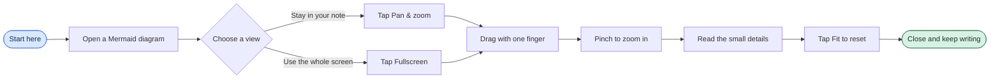
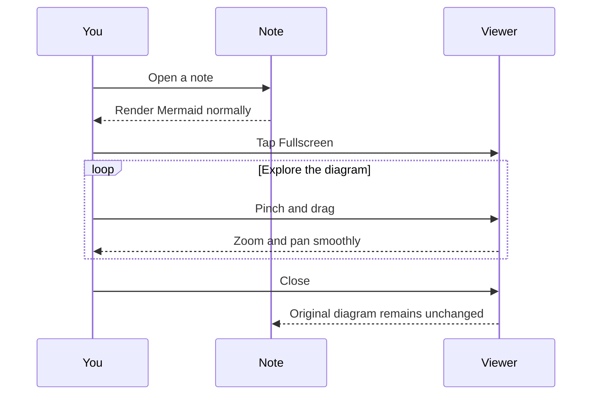
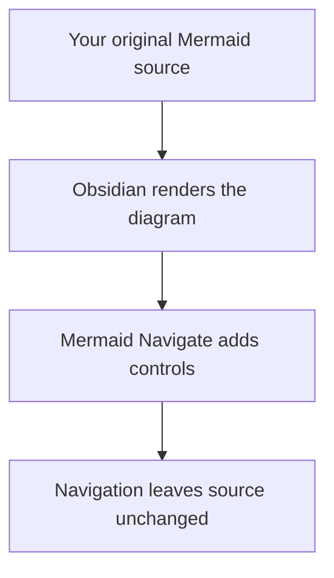

# Mermaid Navigate — Test

Tap **Pan & zoom** below a diagram to explore it inline, or **Fullscreen** for a screen-filling view.

- Drag with one finger to pan.
- Pinch with two fingers to zoom.
- Use **+**, **−**, **Fit**, or **1:1**.
- Tap **✕** to return to your note. Android Back also closes fullscreen.
- Outside an activated viewer, your note scrolls normally.
- **Show code** opens the fullscreen source editor. Edit Mermaid text, then choose **Save** or **Cancel**.
- **Show diagram** keeps your draft but shows the last saved diagram. Closing an unsaved draft asks you to Save or Cancel first.

## Wide flowchart

## Sequence diagram

## Multiple diagrams stay independent

This is a disposable test note added for Mermaid Navigate. You can delete it when finished.
